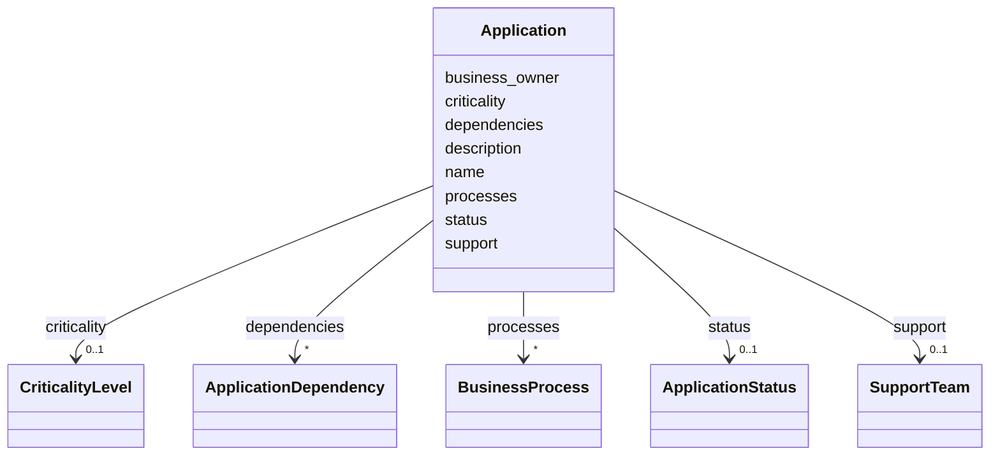

---
search:
  boost: 10.0
---

# Class: Application 


_Application du système d'information._


<div data-search-exclude markdown="1">


URI: [ea:Application](https://w3id.org/ea-lab/enterprise-architecture/Application)





<!-- no inheritance hierarchy -->

## Slots

| Name | Cardinality and Range | Description | Inheritance |
| ---  | --- | --- | --- |
| [name](name.md) | 1 <br/> [String](String.md) | Nom canonique de l'application, unique dans le portefeuille | direct |
| [description](description.md) | 0..1 <br/> [String](String.md) | Description synthétique du rôle de l'application | direct |
| [status](status.md) | 0..1 <br/> [ApplicationStatus](ApplicationStatus.md) | Statut de cycle de vie de l'application | direct |
| [criticality](criticality.md) | 0..1 <br/> [CriticalityLevel](CriticalityLevel.md) | Niveau de criticité métier de l'application | direct |
| [business_owner](business_owner.md) | 0..1 <br/> [String](String.md) | Direction ou entité métier responsable de l'application | direct |
| [support](support.md) | 0..1 <br/> [SupportTeam](SupportTeam.md) | Équipe ou prestataire en charge du support de l'application | direct |
| [processes](processes.md) | * <br/> [BusinessProcess](BusinessProcess.md) | Processus métier appuyés par cette application | direct |
| [dependencies](dependencies.md) | * <br/> [ApplicationDependency](ApplicationDependency.md) | Applications dont dépend cette application | direct |


## Usages

| used by | used in | type | used |
| ---  | --- | --- | --- |
| [ApplicationDependency](ApplicationDependency.md) | [depends_on](depends_on.md) | range | [Application](Application.md) |
| [Portfolio](Portfolio.md) | [applications](applications.md) | range | [Application](Application.md) |


## Identifier and Mapping Information


### Schema Source


* from schema: https://w3id.org/ea-lab/enterprise-architecture


## Mappings

| Mapping Type | Mapped Value |
| ---  | ---  |
| self | ea:Application |
| native | ea:Application |


## LinkML Source

<!-- TODO: investigate https://stackoverflow.com/questions/37606292/how-to-create-tabbed-code-blocks-in-mkdocs-or-sphinx -->

### Direct

<details>
```yaml
name: Application
description: Application du système d'information.
from_schema: https://w3id.org/ea-lab/enterprise-architecture
attributes:
  name:
    name: name
    description: Nom canonique de l'application, unique dans le portefeuille.
    from_schema: https://w3id.org/ea-lab/enterprise-architecture
    identifier: true
    domain_of:
    - BusinessProcess
    - Application
    required: true
  description:
    name: description
    description: Description synthétique du rôle de l'application.
    from_schema: https://w3id.org/ea-lab/enterprise-architecture
    domain_of:
    - BusinessProcess
    - Application
  status:
    name: status
    description: Statut de cycle de vie de l'application.
    from_schema: https://w3id.org/ea-lab/enterprise-architecture
    rank: 1000
    domain_of:
    - Application
    range: ApplicationStatus
  criticality:
    name: criticality
    description: Niveau de criticité métier de l'application.
    from_schema: https://w3id.org/ea-lab/enterprise-architecture
    rank: 1000
    domain_of:
    - Application
    range: CriticalityLevel
  business_owner:
    name: business_owner
    description: Direction ou entité métier responsable de l'application.
    from_schema: https://w3id.org/ea-lab/enterprise-architecture
    rank: 1000
    domain_of:
    - Application
  support:
    name: support
    description: Équipe ou prestataire en charge du support de l'application.
    from_schema: https://w3id.org/ea-lab/enterprise-architecture
    rank: 1000
    domain_of:
    - Application
    range: SupportTeam
  processes:
    name: processes
    description: Processus métier appuyés par cette application.
    from_schema: https://w3id.org/ea-lab/enterprise-architecture
    rank: 1000
    domain_of:
    - Application
    range: BusinessProcess
    multivalued: true
    inlined_as_list: true
  dependencies:
    name: dependencies
    description: Applications dont dépend cette application.
    from_schema: https://w3id.org/ea-lab/enterprise-architecture
    rank: 1000
    domain_of:
    - Application
    range: ApplicationDependency
    multivalued: true
    inlined_as_list: true

```
</details>

### Induced

<details>
```yaml
name: Application
description: Application du système d'information.
from_schema: https://w3id.org/ea-lab/enterprise-architecture
attributes:
  name:
    name: name
    description: Nom canonique de l'application, unique dans le portefeuille.
    from_schema: https://w3id.org/ea-lab/enterprise-architecture
    identifier: true
    owner: Application
    domain_of:
    - BusinessProcess
    - Application
    range: string
    required: true
  description:
    name: description
    description: Description synthétique du rôle de l'application.
    from_schema: https://w3id.org/ea-lab/enterprise-architecture
    owner: Application
    domain_of:
    - BusinessProcess
    - Application
    range: string
  status:
    name: status
    description: Statut de cycle de vie de l'application.
    from_schema: https://w3id.org/ea-lab/enterprise-architecture
    rank: 1000
    owner: Application
    domain_of:
    - Application
    range: ApplicationStatus
  criticality:
    name: criticality
    description: Niveau de criticité métier de l'application.
    from_schema: https://w3id.org/ea-lab/enterprise-architecture
    rank: 1000
    owner: Application
    domain_of:
    - Application
    range: CriticalityLevel
  business_owner:
    name: business_owner
    description: Direction ou entité métier responsable de l'application.
    from_schema: https://w3id.org/ea-lab/enterprise-architecture
    rank: 1000
    owner: Application
    domain_of:
    - Application
    range: string
  support:
    name: support
    description: Équipe ou prestataire en charge du support de l'application.
    from_schema: https://w3id.org/ea-lab/enterprise-architecture
    rank: 1000
    owner: Application
    domain_of:
    - Application
    range: SupportTeam
  processes:
    name: processes
    description: Processus métier appuyés par cette application.
    from_schema: https://w3id.org/ea-lab/enterprise-architecture
    rank: 1000
    owner: Application
    domain_of:
    - Application
    range: BusinessProcess
    multivalued: true
    inlined: true
    inlined_as_list: true
  dependencies:
    name: dependencies
    description: Applications dont dépend cette application.
    from_schema: https://w3id.org/ea-lab/enterprise-architecture
    rank: 1000
    owner: Application
    domain_of:
    - Application
    range: ApplicationDependency
    multivalued: true
    inlined: true
    inlined_as_list: true

```
</details></div>