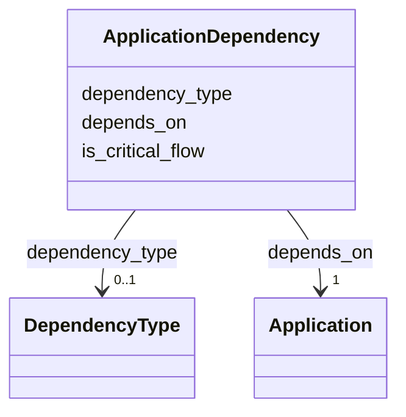

---
search:
  boost: 10.0
---

# Class: ApplicationDependency 


_Dépendance technique ou fonctionnelle entre deux applications._


<div data-search-exclude markdown="1">


URI: [ea:ApplicationDependency](https://w3id.org/ea-lab/enterprise-architecture/ApplicationDependency)





<!-- no inheritance hierarchy -->

## Slots

| Name | Cardinality and Range | Description | Inheritance |
| ---  | --- | --- | --- |
| [depends_on](depends_on.md) | 1 <br/> [Application](Application.md) | Nom canonique de l'application cible de la dépendance (celle dont l'applicati... | direct |
| [dependency_type](dependency_type.md) | 0..1 <br/> [DependencyType](DependencyType.md) | Nature de la dépendance | direct |
| [is_critical_flow](is_critical_flow.md) | 0..1 <br/> [Boolean](Boolean.md) | Vrai si l'interruption de ce flux bloque le métier | direct |


## Usages

| used by | used in | type | used |
| ---  | --- | --- | --- |
| [Application](Application.md) | [dependencies](dependencies.md) | range | [ApplicationDependency](ApplicationDependency.md) |


## Identifier and Mapping Information


### Schema Source


* from schema: https://w3id.org/ea-lab/enterprise-architecture


## Mappings

| Mapping Type | Mapped Value |
| ---  | ---  |
| self | ea:ApplicationDependency |
| native | ea:ApplicationDependency |


## LinkML Source

<!-- TODO: investigate https://stackoverflow.com/questions/37606292/how-to-create-tabbed-code-blocks-in-mkdocs-or-sphinx -->

### Direct

<details>
```yaml
name: ApplicationDependency
description: Dépendance technique ou fonctionnelle entre deux applications.
from_schema: https://w3id.org/ea-lab/enterprise-architecture
attributes:
  depends_on:
    name: depends_on
    description: Nom canonique de l'application cible de la dépendance (celle dont
      l'application courante a besoin).
    from_schema: https://w3id.org/ea-lab/enterprise-architecture
    rank: 1000
    domain_of:
    - ApplicationDependency
    range: Application
    required: true
  dependency_type:
    name: dependency_type
    description: Nature de la dépendance.
    from_schema: https://w3id.org/ea-lab/enterprise-architecture
    rank: 1000
    domain_of:
    - ApplicationDependency
    range: DependencyType
  is_critical_flow:
    name: is_critical_flow
    description: Vrai si l'interruption de ce flux bloque le métier.
    from_schema: https://w3id.org/ea-lab/enterprise-architecture
    rank: 1000
    domain_of:
    - ApplicationDependency
    range: boolean

```
</details>

### Induced

<details>
```yaml
name: ApplicationDependency
description: Dépendance technique ou fonctionnelle entre deux applications.
from_schema: https://w3id.org/ea-lab/enterprise-architecture
attributes:
  depends_on:
    name: depends_on
    description: Nom canonique de l'application cible de la dépendance (celle dont
      l'application courante a besoin).
    from_schema: https://w3id.org/ea-lab/enterprise-architecture
    rank: 1000
    owner: ApplicationDependency
    domain_of:
    - ApplicationDependency
    range: Application
    required: true
  dependency_type:
    name: dependency_type
    description: Nature de la dépendance.
    from_schema: https://w3id.org/ea-lab/enterprise-architecture
    rank: 1000
    owner: ApplicationDependency
    domain_of:
    - ApplicationDependency
    range: DependencyType
  is_critical_flow:
    name: is_critical_flow
    description: Vrai si l'interruption de ce flux bloque le métier.
    from_schema: https://w3id.org/ea-lab/enterprise-architecture
    rank: 1000
    owner: ApplicationDependency
    domain_of:
    - ApplicationDependency
    range: boolean

```
</details></div>