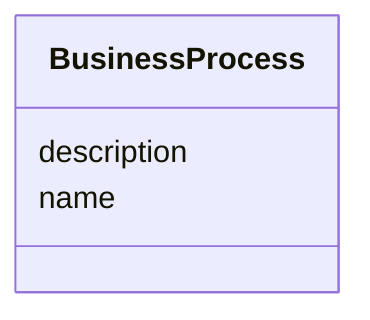

---
search:
  boost: 10.0
---

# Class: BusinessProcess 


_Processus métier de l'entreprise appuyé par des applications._


<div data-search-exclude markdown="1">


URI: [ea:BusinessProcess](https://w3id.org/ea-lab/enterprise-architecture/BusinessProcess)





<!-- no inheritance hierarchy -->

## Slots

| Name | Cardinality and Range | Description | Inheritance |
| ---  | --- | --- | --- |
| [name](name.md) | 1 <br/> [String](String.md) | Nom du processus métier, par exemple « Gestion des campagnes marketing » | direct |
| [description](description.md) | 0..1 <br/> [String](String.md) | Description synthétique du processus | direct |


## Usages

| used by | used in | type | used |
| ---  | --- | --- | --- |
| [Application](Application.md) | [processes](processes.md) | range | [BusinessProcess](BusinessProcess.md) |


## Identifier and Mapping Information


### Schema Source


* from schema: https://w3id.org/ea-lab/enterprise-architecture


## Mappings

| Mapping Type | Mapped Value |
| ---  | ---  |
| self | ea:BusinessProcess |
| native | ea:BusinessProcess |


## LinkML Source

<!-- TODO: investigate https://stackoverflow.com/questions/37606292/how-to-create-tabbed-code-blocks-in-mkdocs-or-sphinx -->

### Direct

<details>
```yaml
name: BusinessProcess
description: Processus métier de l'entreprise appuyé par des applications.
from_schema: https://w3id.org/ea-lab/enterprise-architecture
attributes:
  name:
    name: name
    description: Nom du processus métier, par exemple « Gestion des campagnes marketing
      ».
    from_schema: https://w3id.org/ea-lab/enterprise-architecture
    rank: 1000
    domain_of:
    - BusinessProcess
    - Application
    required: true
  description:
    name: description
    description: Description synthétique du processus.
    from_schema: https://w3id.org/ea-lab/enterprise-architecture
    rank: 1000
    domain_of:
    - BusinessProcess
    - Application

```
</details>

### Induced

<details>
```yaml
name: BusinessProcess
description: Processus métier de l'entreprise appuyé par des applications.
from_schema: https://w3id.org/ea-lab/enterprise-architecture
attributes:
  name:
    name: name
    description: Nom du processus métier, par exemple « Gestion des campagnes marketing
      ».
    from_schema: https://w3id.org/ea-lab/enterprise-architecture
    rank: 1000
    owner: BusinessProcess
    domain_of:
    - BusinessProcess
    - Application
    range: string
    required: true
  description:
    name: description
    description: Description synthétique du processus.
    from_schema: https://w3id.org/ea-lab/enterprise-architecture
    rank: 1000
    owner: BusinessProcess
    domain_of:
    - BusinessProcess
    - Application
    range: string

```
</details></div>