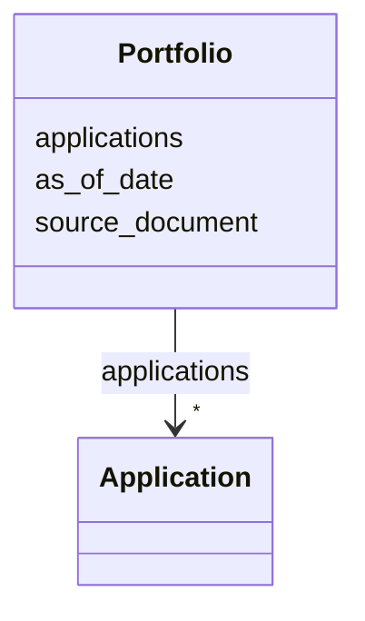

---
search:
  boost: 10.0
---

# Class: Portfolio 


_Vue d'ensemble du paysage applicatif d'une entreprise._


<div data-search-exclude markdown="1">


URI: [ea:Portfolio](https://w3id.org/ea-lab/enterprise-architecture/Portfolio)





<!-- no inheritance hierarchy -->

## Class Properties

| Property | Value |
| --- | --- |
| Tree Root | Yes |


## Slots

| Name | Cardinality and Range | Description | Inheritance |
| ---  | --- | --- | --- |
| [source_document](source_document.md) | 0..1 <br/> [String](String.md) | Origine du recensement (nom du document audité, cabinet, etc | direct |
| [as_of_date](as_of_date.md) | 0..1 <br/> [Date](Date.md) | Date d'état des lieux du paysage applicatif | direct |
| [applications](applications.md) | * <br/> [Application](Application.md) | Liste des applications recensées | direct |


## Identifier and Mapping Information


### Schema Source


* from schema: https://w3id.org/ea-lab/enterprise-architecture


## Mappings

| Mapping Type | Mapped Value |
| ---  | ---  |
| self | ea:Portfolio |
| native | ea:Portfolio |


## LinkML Source

<!-- TODO: investigate https://stackoverflow.com/questions/37606292/how-to-create-tabbed-code-blocks-in-mkdocs-or-sphinx -->

### Direct

<details>
```yaml
name: Portfolio
description: Vue d'ensemble du paysage applicatif d'une entreprise.
from_schema: https://w3id.org/ea-lab/enterprise-architecture
attributes:
  source_document:
    name: source_document
    description: Origine du recensement (nom du document audité, cabinet, etc.).
    from_schema: https://w3id.org/ea-lab/enterprise-architecture
    rank: 1000
    domain_of:
    - Portfolio
  as_of_date:
    name: as_of_date
    description: Date d'état des lieux du paysage applicatif.
    from_schema: https://w3id.org/ea-lab/enterprise-architecture
    rank: 1000
    domain_of:
    - Portfolio
    range: date
  applications:
    name: applications
    description: Liste des applications recensées.
    from_schema: https://w3id.org/ea-lab/enterprise-architecture
    rank: 1000
    domain_of:
    - Portfolio
    range: Application
    multivalued: true
    inlined_as_list: true
tree_root: true

```
</details>

### Induced

<details>
```yaml
name: Portfolio
description: Vue d'ensemble du paysage applicatif d'une entreprise.
from_schema: https://w3id.org/ea-lab/enterprise-architecture
attributes:
  source_document:
    name: source_document
    description: Origine du recensement (nom du document audité, cabinet, etc.).
    from_schema: https://w3id.org/ea-lab/enterprise-architecture
    rank: 1000
    owner: Portfolio
    domain_of:
    - Portfolio
    range: string
  as_of_date:
    name: as_of_date
    description: Date d'état des lieux du paysage applicatif.
    from_schema: https://w3id.org/ea-lab/enterprise-architecture
    rank: 1000
    owner: Portfolio
    domain_of:
    - Portfolio
    range: date
  applications:
    name: applications
    description: Liste des applications recensées.
    from_schema: https://w3id.org/ea-lab/enterprise-architecture
    rank: 1000
    owner: Portfolio
    domain_of:
    - Portfolio
    range: Application
    multivalued: true
    inlined: true
    inlined_as_list: true
tree_root: true

```
</details></div>