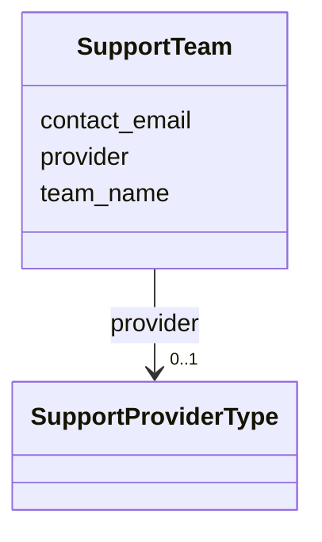

---
search:
  boost: 10.0
---

# Class: SupportTeam 


_Équipe ou contrat assurant le support d'une application._


<div data-search-exclude markdown="1">


URI: [ea:SupportTeam](https://w3id.org/ea-lab/enterprise-architecture/SupportTeam)





<!-- no inheritance hierarchy -->

## Slots

| Name | Cardinality and Range | Description | Inheritance |
| ---  | --- | --- | --- |
| [team_name](team_name.md) | 1 <br/> [String](String.md) | Nom de l'équipe de support ou du prestataire | direct |
| [provider](provider.md) | 0..1 <br/> [SupportProviderType](SupportProviderType.md) | Mode de fourniture du support | direct |
| [contact_email](contact_email.md) | 0..1 <br/> [String](String.md) | Adresse e-mail de contact du support | direct |


## Usages

| used by | used in | type | used |
| ---  | --- | --- | --- |
| [Application](Application.md) | [support](support.md) | range | [SupportTeam](SupportTeam.md) |


## Identifier and Mapping Information


### Schema Source


* from schema: https://w3id.org/ea-lab/enterprise-architecture


## Mappings

| Mapping Type | Mapped Value |
| ---  | ---  |
| self | ea:SupportTeam |
| native | ea:SupportTeam |


## LinkML Source

<!-- TODO: investigate https://stackoverflow.com/questions/37606292/how-to-create-tabbed-code-blocks-in-mkdocs-or-sphinx -->

### Direct

<details>
```yaml
name: SupportTeam
description: Équipe ou contrat assurant le support d'une application.
from_schema: https://w3id.org/ea-lab/enterprise-architecture
attributes:
  team_name:
    name: team_name
    description: Nom de l'équipe de support ou du prestataire.
    from_schema: https://w3id.org/ea-lab/enterprise-architecture
    rank: 1000
    domain_of:
    - SupportTeam
    required: true
  provider:
    name: provider
    description: Mode de fourniture du support.
    from_schema: https://w3id.org/ea-lab/enterprise-architecture
    rank: 1000
    domain_of:
    - SupportTeam
    range: SupportProviderType
  contact_email:
    name: contact_email
    description: Adresse e-mail de contact du support.
    from_schema: https://w3id.org/ea-lab/enterprise-architecture
    rank: 1000
    domain_of:
    - SupportTeam

```
</details>

### Induced

<details>
```yaml
name: SupportTeam
description: Équipe ou contrat assurant le support d'une application.
from_schema: https://w3id.org/ea-lab/enterprise-architecture
attributes:
  team_name:
    name: team_name
    description: Nom de l'équipe de support ou du prestataire.
    from_schema: https://w3id.org/ea-lab/enterprise-architecture
    rank: 1000
    owner: SupportTeam
    domain_of:
    - SupportTeam
    range: string
    required: true
  provider:
    name: provider
    description: Mode de fourniture du support.
    from_schema: https://w3id.org/ea-lab/enterprise-architecture
    rank: 1000
    owner: SupportTeam
    domain_of:
    - SupportTeam
    range: SupportProviderType
  contact_email:
    name: contact_email
    description: Adresse e-mail de contact du support.
    from_schema: https://w3id.org/ea-lab/enterprise-architecture
    rank: 1000
    owner: SupportTeam
    domain_of:
    - SupportTeam
    range: string

```
</details></div>